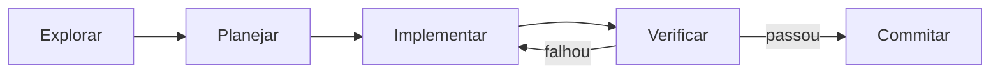

Deixar o agente sair codando direto costuma produzir código que resolve o problema errado. O fluxo recomendado **separa entender e planejar de executar**:



## Explorar

Peça ao agente que **leia e explique** antes de mudar qualquer coisa. Nesta fase, ele só lê arquivos, busca no código e responde perguntas.

```text title="Exemplo de pedido"
Leia src/auth e explique como funcionam sessão e login.
Veja também como os segredos são carregados das variáveis de ambiente.
Não altere nada ainda.
```

Use o **modo de planejamento** da ferramenta. Ele bloqueia edições, então o agente não "aproveita" para mudar código:

<NaPratica>
<TabItem value="opencode">

Alterne para o agente **plan** com a tecla <kbd>Tab</kbd>. Por padrão, ele não edita arquivos, exceto os planos em `.opencode/plans/`. Volte ao agente **build** com <kbd>Tab</kbd> para implementar.

</TabItem>
<TabItem value="cline">

Use o modo **Plan**: o Cline lê o código, busca e discute estratégia, mas não modifica arquivos nem executa comandos. Quando o plano estiver bom, mude para **Act**, e o histórico da conversa é mantido. Dá para usar modelos diferentes em cada modo (Settings → "Use different models for Plan and Act").

</TabItem>
<TabItem value="claude-code">

Ative o **plan mode** com <kbd>Shift</kbd>+<kbd>Tab</kbd> até aparecer `plan mode on`, ou inicie com `claude --permission-mode plan`. Para editar o plano no seu editor antes de aprovar, use <kbd>Ctrl</kbd>+<kbd>G</kbd>.

</TabItem>
<TabItem value="antigravity">

Use o modo de **planejamento** da conversa, que gera um plano para revisão antes da execução. No CLI, a configuração equivalente é `agentMode: "plan"`. Revise o plano antes de aprovar tarefas grandes.

</TabItem>
</NaPratica>

## Planejar

Peça um plano concreto: quais arquivos mudam, em que ordem, como será verificado e o que fica fora do escopo.

```text title="Exemplo de pedido"
Quero adicionar login com OAuth do Google. Quais arquivos precisam mudar?
Como fica o fluxo de sessão? Escreva um plano, incluindo como vamos testar.
```

**Revise o plano como revisaria o design de um colega.** É o momento mais barato para corrigir a direção.

:::tip[Quando pular o plano]
Planejar tem custo. Se você consegue descrever o diff em uma frase (corrigir um typo, renomear uma variável, adicionar um log), peça direto. O plano vale a pena quando a abordagem é incerta, quando a mudança toca vários arquivos ou quando você não conhece o código.
:::

Para funcionalidades grandes, peça que o agente **entreviste você** sobre requisitos, casos de borda e trade-offs, e escreva uma especificação (por exemplo `SPEC.md`). Depois, implemente numa **sessão nova**, com o contexto limpo e a especificação como referência.

## Implementar

Saia do modo de planejamento e peça a implementação **seguindo o plano**, incluindo testes:

```text title="Exemplo de pedido"
Implemente o fluxo OAuth conforme o plano. Escreva testes para o
callback, rode a suíte de testes e corrija as falhas.
```

Corrija o rumo **cedo**: se o agente começar a ir pelo caminho errado, interrompa e redirecione. Não espere ele terminar.

## Verificar

Esta é a prática que mais muda a qualidade do resultado: **dê ao agente uma forma de checar o próprio trabalho**. Com uma checagem que retorna passou ou falhou, ele itera sozinho até passar. Sem ela, quem verifica cada erro é você.

| Estratégia | Pedido fraco | Pedido melhor |
|---|---|---|
| Critério de verificação | "implemente uma função que valida e-mails" | "escreva `validateEmail`. Casos: `user@example.com` → true, `invalido` → false, `user@.com` → false. Rode os testes depois" |
| Verificação visual | "melhore o dashboard" | "[captura de tela] implemente este design, tire uma captura do resultado, compare com o original e corrija as diferenças" |
| Causa raiz | "o build está falhando" | "o build falha com este erro: [erro]. Corrija e confirme que o build passa. Trate a causa, não suprima o erro" |

Peça **evidência**: a saída dos testes, o comando executado e o resultado. Conferir evidência é mais rápido do que refazer a verificação, e funciona mesmo quando você não acompanhou a sessão.

:::tip[Revisão independente]
Antes de considerar uma tarefa grande concluída, peça uma revisão do diff num **contexto novo**: um subagente, outra sessão ou outra ferramenta. Quem revisa não deve ser quem escreveu, porque o revisor sem o histórico não herda os vieses da implementação. Peça que ele aponte só problemas de correção e de requisitos, para não cair em engenharia excessiva.
:::

## Commitar

Peça ao agente uma mensagem de commit descritiva e, se for o caso, a abertura do PR. Antes de submeter:

- leia o diff inteiro (regra [R1](/regras));
- declare o uso do agente (regra [R6](/regras)).

## Como pedir bem

O agente infere a intenção, mas não lê pensamentos. Quanto mais preciso o pedido, menos correções você vai precisar fazer.

| Estratégia | Pedido fraco | Pedido melhor |
|---|---|---|
| Delimitar a tarefa | "adicione testes para foo.py" | "escreva um teste para foo.py cobrindo o caso de usuário deslogado. Evite mocks" |
| Apontar a fonte | "por que essa API é tão estranha?" | "leia o histórico do git de `ExecutionFactory` e resuma como a API chegou a esse formato" |
| Referenciar padrões existentes | "adicione um widget de calendário" | "veja como os widgets da home são implementados (`HotDogWidget` é um bom exemplo) e siga o mesmo padrão" |
| Descrever o sintoma | "conserte o bug de login" | "o login falha depois que a sessão expira. Verifique o refresh de token em `src/auth/`. Escreva um teste que reproduza o erro e depois corrija" |

Outras formas de dar contexto:

- **Referencie arquivos** em vez de descrever onde o código está (a maioria das ferramentas aceita `@arquivo`).
- **Cole imagens** (capturas de tela, diagramas) e **mensagens de erro completas**.
- **Passe URLs** de documentação.
- **Deixe o agente buscar o que precisa**: ler arquivos, rodar comandos de consulta, usar CLIs como `gh`.

Pedidos vagos também têm seu lugar: na **exploração**, perguntas como "o que você melhoraria neste arquivo?" revelam coisas em que você não teria pensado.

## Fontes

- Anthropic — [Best practices for Claude Code](https://code.claude.com/docs/en/best-practices): *Explore first, then plan, then code*; *Give Claude a way to verify its work*; *Provide specific context*.
- OpenCode — [Agents](https://opencode.ai/docs/agents/).
- Cline — [Plan & Act](https://docs.cline.bot/features/plan-and-act).
- Antigravity — [Settings](https://antigravity.google/docs/settings?tab=ide).
