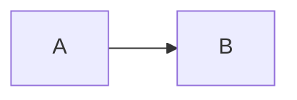

O guia é mantido no repositório [havillonf/ai-usage-standards](https://github.com/havillonf/ai-usage-standards). O site é feito em React + TypeScript (Vite), mas a maior parte do conteúdo é **Markdown** ou **dados em TypeScript**. Para contribuir com texto, não é preciso saber React.

## Formas de contribuir

- **Sugestão ou correção:** abra uma *issue* no repositório.
- **Edição direta:** use o link "Sugerir uma mudança neste artigo", no fim de cada artigo, e abra um PR.
- **Regras obrigatórias:** mudanças nas regras R1–R7 só entram com **aprovação da coordenação** do ATLab. Proponha numa issue.

## Rodando localmente

Requer Node.js 20 ou mais recente.

```bash
npm ci          # instala as dependências
npm run dev     # servidor de desenvolvimento em http://localhost:5173/ai-usage-standards/
npm test        # testes, inclusive a verificação de links e âncoras internos
npm run build   # build de produção em dist/
npm run preview # serve o build localmente
```

## Onde fica cada coisa

| Conteúdo | Arquivo |
|---|---|
| Roteiros guiados (perguntas e passos) | `src/content/roteiros/*.ts` |
| Perguntas reutilizadas (ferramenta, tipo de projeto) | `src/content/perguntas.ts` |
| Artigos de "Aprofundar" | `src/content/artigos/<slug>.mdx` e a lista de categorias em `src/content/artigos.ts` |
| Regras obrigatórias | `src/data/regras.ts` |
| Ferramentas de referência | `src/data/ferramentas.ts` |
| Matriz de compatibilidade | `src/data/compatibilidade.ts` |
| Geradores (AGENTS.md, permissões) | `src/geradores/*.ts` |
| Cores e fontes (tema) | `src/styles/tokens.css` |

## Escrevendo um passo de roteiro

Cada passo é um objeto em TypeScript, e os textos são Markdown:

```ts title="src/content/roteiros/exemplo.ts"
{
  id: 'proteger-segredos',
  titulo: 'Proteja segredos',
  resumo: 'O que fazer, em uma ou duas frases.',
  instrucoes: {
    generico: 'Instrução para qualquer ferramenta (obrigatória).',
    opencode: 'Instrução específica do OpenCode.',
    cline: 'Instrução específica do Cline.',
  },
  regras: ['R2'],
  blocos: [
    {tipo: 'prompt', titulo: 'Validar', texto: 'Prompt pronto para copiar.'},
    {tipo: 'arquivo', ferramentas: ['opencode'], arquivo: 'opencode.json', linguagem: 'json', conteudo: '{}'},
    {tipo: 'lista', titulo: 'Confira', itens: ['Item 1', 'Item 2']},
  ],
  porque: {texto: 'Explicação curta.', artigo: 'segredos'},
  fontes: [{titulo: 'Documentação', url: 'https://…'}],
  quando: (r) => r.projeto === 'infra', // opcional: só aparece para algumas respostas
}
```

- `instrucoes.generico` é obrigatório: é o que aparece para "Outro / ainda não uso".
- Um texto que depende das respostas pode ser uma função: `(r) => …`.
- Os tipos de bloco disponíveis são: `prompt`, `arquivo`, `codigo`, `lista`, `aviso`, `checklist`, `gerador` e `arvore`. Eles estão descritos em `src/content/tipos.ts`.

## Escrevendo um artigo

1. Crie `src/content/artigos/<slug>.mdx`, com `title` e `description` no frontmatter.
2. Inclua o slug numa categoria em `src/content/artigos.ts`.
3. Escreva primeiro o **conceito**, sem citar ferramentas. Depois, o bloco **Na prática**.
4. Termine com uma seção **Fontes**.

Componentes disponíveis nos artigos, sem import:

| Componente | Uso |
|---|---|
| `<Regra id="R2" />` | Mostra uma regra obrigatória, com o texto de `src/data/regras.ts`. |
| `<NaPratica>` + `<TabItem value="…">` | Abas por ferramenta: `opencode`, `cline`, `claude-code`, `antigravity`. |
| `<MatrizCompatibilidade />` | Tabela de compatibilidade. Aceita `recursos={['skills', 'mcp']}`. |
| `<ArvoreDecisao />` | A árvore interativa "onde coloco isso?". |

Deixe uma linha em branco depois de `<TabItem …>` e antes de `</TabItem>`. Sem essas linhas, o Markdown de dentro não é processado.

Caixas de destaque e diagramas:

````md
:::tip[Recomendação]
Texto da recomendação.
:::


````

Os tipos de caixa são `tip`, `info`, `note`, `warning` e `danger`. Links internos usam a rota do site, por exemplo `[Segredos](/aprofundar/segredos)`. Os testes falham se uma rota ou âncora não existir.

## Convenções de escrita

- Escreva em **português do Brasil**. Termos técnicos consagrados (skill, hook, prompt, MCP) ficam em inglês.
- Use **DEVE / NÃO DEVE** só para regras obrigatórias. Para o resto, use "recomenda-se", "prefira", "evite".
- **Informações sobre ferramentas** levam um link para a fonte oficial. O que não foi confirmado fica como "a verificar".
- **Não cite modelos específicos.** Fale de capacidades: contexto, chamada de ferramentas, raciocínio.

## Matriz de compatibilidade

Cada célula de `src/data/compatibilidade.ts` tem `suporte` (`sim`, `parcial`, `nao` ou `verificar`), uma `nota` opcional e a `fonte`. Os testes exigem uma fonte em toda célula que não esteja como `verificar`. Ao revisar a matriz inteira, atualize `VERIFICADO_EM`.

## Licença

O conteúdo é licenciado sob [CC BY 4.0](https://creativecommons.org/licenses/by/4.0/deed.pt_BR). Ao contribuir, você concorda em licenciar sua contribuição nos mesmos termos.
