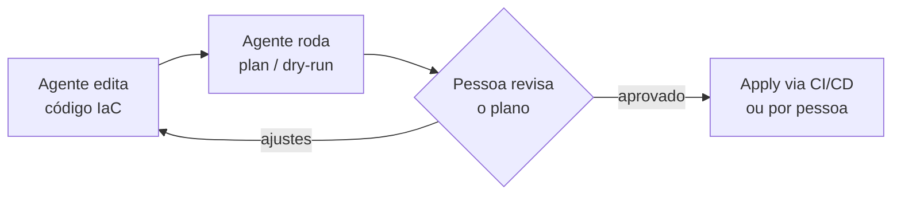

<Regra id="R4" />

Um comando errado em produção pode apagar dados, derrubar um serviço ou gerar custo. Um agente executa comandos rápido e com confiança, inclusive quando está errado. Por isso, quanto mais irreversível a ação, mais perto dela precisa estar uma pessoa.

## O que conta como ação destrutiva

- Apagar arquivos, diretórios, branches, volumes, buckets, bancos de dados ou tabelas.
- Reescrever histórico: `git push --force`, `git reset --hard` em branches compartilhados.
- Alterar infraestrutura: `terraform apply`, `kubectl delete` e `kubectl apply` em clusters reais, mudanças de DNS e de firewall.
- Executar migrações e `UPDATE`/`DELETE` sem `WHERE` em bancos reais.
- Mudar permissões, usuários, chaves e segredos.
- Qualquer ação que gere custo financeiro ou envie algo a terceiros (e-mails, notificações, publicações).

## Recomendações

- **O agente não recebe credenciais de produção.** Para diagnóstico, use acesso **somente leitura** e com escopo restrito.
- **Infraestrutura como código, sempre via plano.** O agente pode escrever e alterar o código da infraestrutura e rodar `plan`, `diff` ou `--dry-run`. Quem aplica é uma pessoa, depois de ler o plano, ou o pipeline de CI/CD com revisão.
- **Ambientes separados.** O agente trabalha em desenvolvimento, em staging ou numa cópia. Nunca diretamente no ambiente real.
- **Negue explicitamente os comandos destrutivos** nas [regras de permissão](/aprofundar/permissoes) (`rm -rf`, `git push --force`, `kubectl delete`, `terraform apply`, `DROP`). Uma regra `deny` funciona mesmo quando o modelo "decide" executar.
- **Tenha como desfazer**: backups testados, commits antes de cada etapa, checkpoints da ferramenta. Atenção: checkpoints de agentes costumam desfazer **apenas edições de arquivo**, e não efeitos de comandos de shell.
- **Logs e saídas de produção são dados não confiáveis** e podem conter dados pessoais ou segredos. Filtre antes de passar ao agente ([Prompt injection](/aprofundar/prompt-injection), [Segredos](/aprofundar/segredos)).
- **Para troubleshooting**, peça que o agente **proponha** os comandos e explique o que cada um faz. Execute você mesmo os que alteram estado.

## Exemplo de fluxo seguro com IaC

## Fontes

- Anthropic — [Configure permissions](https://code.claude.com/docs/en/permissions).
- Anthropic — [Best practices for Claude Code](https://code.claude.com/docs/en/best-practices): *Rewind with checkpoints* (limites dos checkpoints).
- OWASP — [Top 10 for LLM Applications](https://genai.owasp.org/llm-top-10/): *Excessive Agency*.
